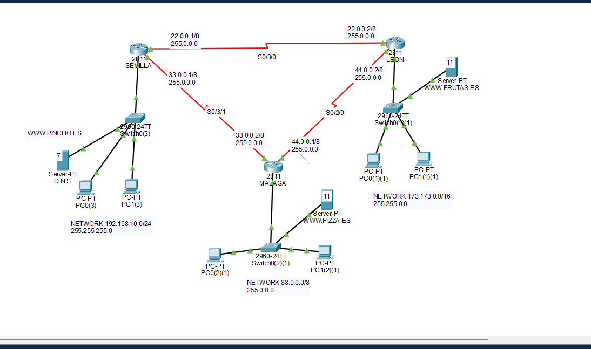
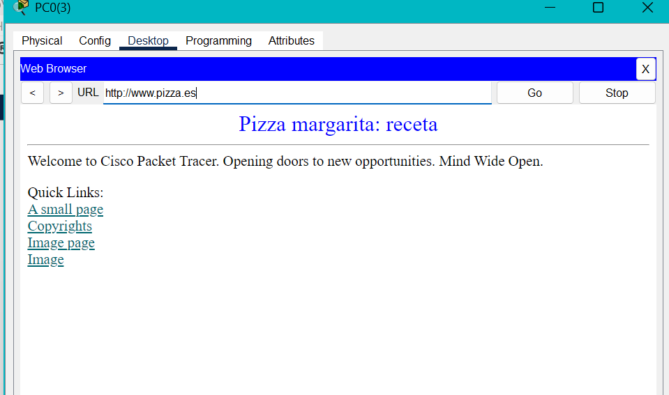
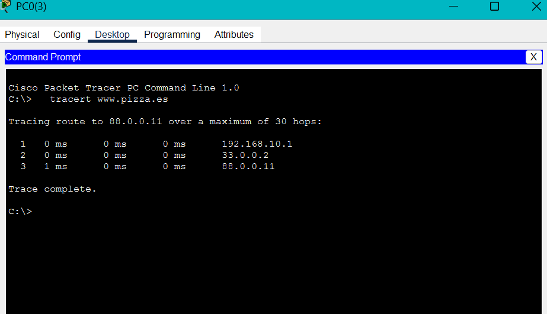

# Multi-site network with DNS and web services — Cisco Packet Tracer

Lab built in Cisco Packet Tracer as part of my ASIR studies (IT systems & networks).
Three sites (Sevilla, Málaga, León) are connected through serial WAN links. Each site has its own LAN with a web server, and a central DNS server lets any PC reach the websites of the other sites by name.



📁 Packet Tracer file: [`multisite-dns-network.pkt`](multisite-dns-network.pkt) (open it with Cisco Packet Tracer)

---

## 🎯 Objective

- Connect three routers through serial point-to-point links.
- Configure one LAN per site.
- Set up routing so every LAN can reach every other LAN.
- Configure a DNS server and three web servers (`www.pincho.es`, `www.pizza.es`, `www.frutas.es`).
- Verify that any PC can open any website by its domain name.

## 🧱 Devices

| Site | Router | Switch | Servers | PCs |
|---|---|---|---|---|
| Sevilla | Cisco 2811 | Cisco 2960-24TT | DNS · www.pincho.es | 2 |
| Málaga | Cisco 2811 | Cisco 2960-24TT | www.pizza.es | 2 |
| León | Cisco 2811 | Cisco 2960-24TT | www.frutas.es | 2 |

## 🌐 Addressing

### Router interfaces

| Router | Interface | IP | Connects to |
|---|---|---|---|
| Sevilla | Fa0/0 | 192.168.10.1/24 | Sevilla LAN |
| Sevilla | S0/3/0 | 22.0.0.1/8 | León |
| Sevilla | S0/3/1 | 33.0.0.1/8 | Málaga |
| Málaga | Fa0/0 | 88.0.0.1/8 | Málaga LAN |
| Málaga | S0/3/1 | 33.0.0.2/8 | Sevilla |
| Málaga | S0/2/0 | 44.0.0.1/8 | León |
| León | Fa0/0 | 173.173.0.1/16 | León LAN |
| León | S0/3/0 | 22.0.0.2/8 | Sevilla |
| León | S0/2/0 | 44.0.0.2/8 | Málaga |

### LANs

| Site | Network | Mask | Gateway |
|---|---|---|---|
| Sevilla | 192.168.10.0/24 | 255.255.255.0 | 192.168.10.1 |
| Málaga | 88.0.0.0/8 | 255.0.0.0 | 88.0.0.1 |
| León | 173.173.0.0/16 | 255.255.0.0 | 173.173.0.1 |

---

## ⌨️ Router configuration (CLI)

Same steps on every router, changing the IPs. Example: **Málaga**.

```
Router> enable
Router# configure terminal

! LAN interface (gateway for the PCs)
Router(config)# interface FastEthernet0/0
Router(config-if)# ip address 88.0.0.1 255.0.0.0
Router(config-if)# no shutdown
Router(config-if)# exit

! Serial link to Sevilla
Router(config)# interface Serial0/3/1
Router(config-if)# ip address 33.0.0.2 255.0.0.0
Router(config-if)# clock rate 64000      ! only on the DCE end of the cable
Router(config-if)# no shutdown
Router(config-if)# exit

! Serial link to León
Router(config)# interface Serial0/2/0
Router(config-if)# ip address 44.0.0.1 255.0.0.0
Router(config-if)# no shutdown
Router(config-if)# exit

! Static routes to the remote LANs
Router(config)# ip route 192.168.10.0 255.255.255.0 33.0.0.1
Router(config)# ip route 173.173.0.0 255.255.0.0 44.0.0.2

Router(config)# end
Router# copy running-config startup-config
```

| Command | What it does |
|---|---|
| `enable` | Enters privileged mode (`Router#`). Needed for `show running-config` |
| `configure terminal` | Enters global configuration mode |
| `interface <name>` | Selects the interface to configure |
| `ip address <ip> <mask>` | Assigns the IP to the interface |
| `no shutdown` | Turns the interface on (router interfaces are off by default) |
| `clock rate 64000` | Sets the link speed. Only on the DCE end of a serial cable (see below) |
| `ip route <network> <mask> <next hop>` | Static route: "to reach this network, send to this neighbour" |
| `end` | Goes back to `Router#` |
| `copy running-config startup-config` | Saves the config so it survives a reboot |
| `do <command>` | Runs a `show` command from inside configuration mode |

### Useful `show` commands

| Command | What it shows |
|---|---|
| `show ip route` | Routing table |
| `show ip interface brief` | All interfaces, their IP and whether they are up/down |
| `show running-config` | Current configuration (needs `enable`) |
| `show controllers serial 0/3/0` | Whether that end of the serial cable is DCE or DTE |

### DCE and DTE on serial links

A serial cable has two different ends:

- **DCE** (Data Communications Equipment): provides the clock signal that sets the speed of the link. In a real WAN this is the provider's equipment (modem/CSU-DSU).
- **DTE** (Data Terminal Equipment): receives that clock. Normally the router.

In a lab two routers are connected directly, so one of them has to play the provider's role: the end with the DCE side of the cable needs `clock rate`, otherwise the link may not come up. In Packet Tracer, with the **Serial DCE** cable, the DCE end is the router you click first (a clock icon appears on that end of the link). To check it:

```
Router# show controllers serial 0/3/1
```

The output starts with `DCE` or `DTE`.

### Static routes per router

| Router | Destination | Next hop |
|---|---|---|
| Sevilla | 88.0.0.0/8 (Málaga LAN) | 33.0.0.2 |
| Sevilla | 173.173.0.0/16 (León LAN) | 22.0.0.2 |
| Málaga | 192.168.10.0/24 (Sevilla LAN) | 33.0.0.1 |
| Málaga | 173.173.0.0/16 (León LAN) | 44.0.0.2 |
| León | 192.168.10.0/24 (Sevilla LAN) | 22.0.0.1 |
| León | 88.0.0.0/8 (Málaga LAN) | 44.0.0.1 |

Each router sends traffic for a remote LAN directly to that site's router over the shared link.

<details>
<summary><code>show ip route</code> — Sevilla</summary>

```
     22.0.0.0/8 is variably subnetted, 2 subnets, 2 masks
C       22.0.0.0/8 is directly connected, Serial0/3/0
L       22.0.0.1/32 is directly connected, Serial0/3/0
     33.0.0.0/8 is variably subnetted, 2 subnets, 2 masks
C       33.0.0.0/8 is directly connected, Serial0/3/1
L       33.0.0.1/32 is directly connected, Serial0/3/1
S    88.0.0.0/8 [1/0] via 33.0.0.2
S    173.173.0.0/16 [1/0] via 22.0.0.2
     192.168.10.0/24 is variably subnetted, 2 subnets, 2 masks
C       192.168.10.0/24 is directly connected, FastEthernet0/0
L       192.168.10.1/32 is directly connected, FastEthernet0/0
```
</details>

<details>
<summary><code>show ip route</code> — Málaga</summary>

```
     33.0.0.0/8 is variably subnetted, 2 subnets, 2 masks
C       33.0.0.0/8 is directly connected, Serial0/3/1
L       33.0.0.2/32 is directly connected, Serial0/3/1
     44.0.0.0/8 is variably subnetted, 2 subnets, 2 masks
C       44.0.0.0/8 is directly connected, Serial0/2/0
L       44.0.0.1/32 is directly connected, Serial0/2/0
     88.0.0.0/8 is variably subnetted, 2 subnets, 2 masks
C       88.0.0.0/8 is directly connected, FastEthernet0/0
L       88.0.0.1/32 is directly connected, FastEthernet0/0
S    173.173.0.0/16 [1/0] via 44.0.0.2
S    192.168.10.0/24 [1/0] via 33.0.0.1
```
</details>

<details>
<summary><code>show ip route</code> — León</summary>

```
     22.0.0.0/8 is variably subnetted, 2 subnets, 2 masks
C       22.0.0.0/8 is directly connected, Serial0/3/0
L       22.0.0.2/32 is directly connected, Serial0/3/0
     44.0.0.0/8 is variably subnetted, 2 subnets, 2 masks
C       44.0.0.0/8 is directly connected, Serial0/2/0
L       44.0.0.2/32 is directly connected, Serial0/2/0
S    88.0.0.0/8 [1/0] via 44.0.0.1
     173.173.0.0/16 is variably subnetted, 2 subnets, 2 masks
C       173.173.0.0/16 is directly connected, FastEthernet0/0
L       173.173.0.1/32 is directly connected, FastEthernet0/0
S    192.168.10.0/24 [1/0] via 22.0.0.1
```
</details>

**Reading the table:** **C** = directly connected network · **L** = the router's own IP on that interface · **S** = static route · `[1/0]` = administrative distance 1 (static) / metric 0.

---

## 💻 IP configuration of PCs and servers

In Packet Tracer: click the device → **Desktop** → **IP Configuration**.

### Static (servers, and PCs in this lab)

Each device needs four values:

| Field | Example (PC in Málaga) | What it is |
|---|---|---|
| IP Address | 88.0.0.12 | Unique address inside the LAN |
| Subnet Mask | 255.0.0.0 | Same mask as the LAN |
| Default Gateway | 88.0.0.1 | The router's Fa0/0 IP in that LAN |
| DNS Server | 192.168.10.7 | IP of the DNS server in Sevilla |

| Server | IP |
|---|---|
| DNS · www.pincho.es (Sevilla) | 192.168.10.7 |
| www.pizza.es (Málaga) | 88.0.0.11 |
| www.frutas.es (León) | 173.173.0.11 |

**Servers must keep static IPs:** the DNS records point to a fixed address, and the PCs point to a fixed DNS server. If a server's IP changed, its name would stop resolving.

### Dynamic (DHCP) for the PCs

PCs don't need a fixed address, so DHCP can configure them automatically instead of one by one. The simplest option is a DHCP pool on each router:

```
Router(config)# ip dhcp excluded-address 88.0.0.1 88.0.0.20
Router(config)# ip dhcp pool MALAGA
Router(dhcp-config)# network 88.0.0.0 255.0.0.0
Router(dhcp-config)# default-router 88.0.0.1
Router(dhcp-config)# dns-server 192.168.10.7
```

| Command | What it does |
|---|---|
| `ip dhcp excluded-address` | Reserves a range that DHCP will never hand out (router, servers). Here it protects the web server at 88.0.0.11 |
| `ip dhcp pool <name>` | Creates the pool for one LAN |
| `network` | Range of addresses to hand out |
| `default-router` | Gateway the PCs will receive |
| `dns-server` | DNS server the PCs will receive |

Then on each PC: **IP Configuration** → select **DHCP**. The PC receives IP, mask, gateway and DNS on its own.

> A single central DHCP server (for example in Sevilla) would also work, but DHCP requests are broadcasts and don't cross routers. The other routers would need `ip helper-address <DHCP server IP>` on their LAN interface to forward them.

---

## 📇 DNS and web services

The DNS server in Sevilla resolves the three domains:

| Domain | Type | IP |
|---|---|---|
| www.pincho.es | A | 192.168.10.7 |
| www.pizza.es | A | 88.0.0.11 |
| www.frutas.es | A | 173.173.0.11 |

All PCs use the Sevilla DNS server (192.168.10.7), so name resolution works from any site. The same server also hosts `www.pincho.es`.

**`nslookup www.frutas.es`:**

```
C:\>nslookup www.frutas.es

Server: [192.168.10.7]
Address:  192.168.10.7
DNS request timed out.
        timeout was 15000 milli seconds.

Server: [192.168.10.7]
Address:  192.168.10.7

Non-authoritative answer:
Name:   www.frutas.es
Address:   173.173.0.11
```

The first request times out and the retry succeeds. The PC did not yet know the MAC address of the DNS server, so the first query was dropped while ARP resolved it. Running the same command again confirms it, because it now answers straight away:

```
C:\>nslookup www.frutas.es

Server: [192.168.10.7]
Address:  192.168.10.7

Non-authoritative answer:
Name:   www.frutas.es
Address:   173.173.0.11
```

*"Non-authoritative answer"* normally means the reply came from a server that is not the owner of the domain (for example, from its cache). Here the Sevilla DNS server holds the records itself; Packet Tracer simplifies this and shows the label anyway. The IP returned is correct.

## ✅ Testing

- [ ] `ping` between PCs in different sites
- [x] `tracert` from Sevilla to `www.pizza.es`
- [x] Open `www.pizza.es` from a PC in Sevilla (PC0)
- [x] `nslookup www.frutas.es` resolves to 173.173.0.11
- [ ] Open `www.frutas.es` from a PC in Sevilla
- [ ] Open `www.pincho.es` from Málaga and León

**`www.pizza.es` (Málaga) opened from PC0 in Sevilla:** DNS resolves the name and the request crosses the WAN to the Málaga web server.



**`tracert www.pizza.es` from PC0 in Sevilla:**

```
Tracing route to 88.0.0.11 over a maximum of 30 hops:

  1   0 ms   0 ms   0 ms   192.168.10.1
  2   0 ms   0 ms   0 ms   33.0.0.2
  3   1 ms   0 ms   0 ms   88.0.0.11

Trace complete.
```

| Hop | IP | Device |
|---|---|---|
| 1 | 192.168.10.1 | Sevilla router (LAN gateway) |
| 2 | 33.0.0.2 | Málaga router (Sevilla ↔ Málaga serial link) |
| 3 | 88.0.0.11 | www.pizza.es web server |

The name is resolved to 88.0.0.11 by the DNS server, and traffic takes the direct Sevilla → Málaga link instead of going through León, which is the shortest path.



---

## 🔍 Design review: what I would change in a real network

The addressing scheme was given by the exercise. It works inside Packet Tracer, but a real network would need several changes.

### 1. Public IP ranges used as internal addresses

Only the Sevilla LAN uses a private range. The other networks (22.0.0.0/8, 33.0.0.0/8, 44.0.0.0/8, 88.0.0.0/8, 173.173.0.0/16) are **public, routable ranges allocated to real organisations**.

If this network were connected to the Internet:
- Hosts would be unable to reach the real owners of those addresses, because traffic would stay inside our network.
- Routes could leak and conflict with real Internet routes.

Internal networks should use the private ranges defined in **RFC 1918**:

| Range | Block |
|---|---|
| 10.0.0.0 – 10.255.255.255 | 10.0.0.0/8 |
| 172.16.0.0 – 172.31.255.255 | 172.16.0.0/12 |
| 192.168.0.0 – 192.168.255.255 | 192.168.0.0/16 |

### 2. Oversized masks

- **Point-to-point links:** a /8 gives 16,777,214 usable addresses for a link that only needs 2. The standard is a **/30** (2 usable hosts). Many real networks use a **/31** (RFC 3021), which wastes no addresses at all.
- **LANs:** 88.0.0.0/8 and 173.173.0.0/16 are far bigger than three hosts need. Oversized networks waste address space and make route summarisation and documentation harder.

#### Proposed addressing

| Segment | Network | Mask | Addresses |
|---|---|---|---|
| Sevilla LAN | 192.168.10.0/24 | 255.255.255.0 | .1 gateway |
| Málaga LAN | 192.168.20.0/24 | 255.255.255.0 | .1 gateway |
| León LAN | 192.168.30.0/24 | 255.255.255.0 | .1 gateway |
| Sevilla ↔ León | 10.0.0.0/30 | 255.255.255.252 | Sevilla .1 · León .2 |
| Sevilla ↔ Málaga | 10.0.0.4/30 | 255.255.255.252 | Sevilla .5 · Málaga .6 |
| Málaga ↔ León | 10.0.0.8/30 | 255.255.255.252 | Málaga .9 · León .10 |

With this scheme all LANs fit into 192.168.0.0/16 and all links into 10.0.0.0/28, which keeps routing tables small and the design easy to read.

### 3. No redundancy with static routes

The three routers form a triangle, so there is a backup path between any two sites. However, each static route points to only one next hop. If the Sevilla ↔ Málaga link went down, Sevilla would lose access to Málaga even though the path through León still works.

Two ways to fix it:
- **Floating static routes:** a second static route through the other neighbour with a higher administrative distance, used only if the main one fails.
  ```
  Router(config)# ip route 88.0.0.0 255.0.0.0 22.0.0.2 10
  ```
- **A dynamic routing protocol (OSPF):** routers detect the failure and recalculate the path automatically. This scales better as the network grows.

### 4. WAN links are not reachable from every site

Each router only has routes to the remote **LANs**, not to the link between the other two routers (Sevilla has no route to 44.0.0.0, Málaga none to 22.0.0.0, León none to 33.0.0.0). Users are not affected, but it limits management and troubleshooting: a `ping` to those router interfaces fails, and `tracert` can show timeouts on hops that are actually working. With OSPF every network is advertised automatically; with static routes they must be added by hand, for example on Sevilla:

```
Router(config)# ip route 44.0.0.0 255.0.0.0 33.0.0.2
```

### 5. Device hostnames

The routers keep the default hostname (`Router`), even though the diagram labels them Sevilla, Málaga and León. Setting a hostname (`hostname SEVILLA`) makes the CLI, logs and troubleshooting much clearer.

## 📚 What I learned

Building the network itself was straightforward. Most of what I learned came afterwards, when documenting and reviewing it:

- **DCE vs DTE.** I connected the serial links without knowing what the DCE end was. While writing this up I learned that one end of a serial cable provides the clock, and in a lab one router has to take the provider's role.
- **ARP and the first lost packet.** The first `nslookup` timed out and the second worked. The reason is that the first packet is dropped while ARP resolves the MAC address.
- **Reading a routing table.** What C, L and S mean, and what the administrative distance in `[1/0]` is.
- **Working is not the same as well designed.** The network does its job, but reviewing it showed public ranges used internally, oversized masks, no failover between sites and missing routes to the WAN links.
