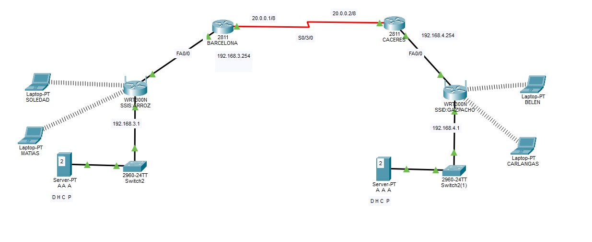

# Two-site network with WPA2-Enterprise Wi-Fi (RADIUS) and SSH — Cisco Packet Tracer

Lab built in Cisco Packet Tracer as part of my ASIR studies (IT systems & networks).
Two sites (Barcelona and Cáceres) are connected through a serial WAN link. Each site has a wireless network secured with **WPA2-Enterprise**: users authenticate against a RADIUS (AAA) server, which also hands out IP addresses through DHCP. The Barcelona router is managed remotely over **SSH**, and Telnet is blocked.



📁 Packet Tracer file: [`02-wpa2-enterprise-radius-ssh.pkt`](02-wpa2-enterprise-radius-ssh.pkt) (open it with Cisco Packet Tracer)

---

## 🎯 Objective

- Connect two routers through a serial point-to-point link.
- Set up static routing so both LANs can reach each other.
- Deploy one wireless network per site secured with WPA2-Enterprise (802.1X) instead of a shared password.
- Configure a server per site as RADIUS (AAA) server and DHCP server.
- Allow remote management of the router over SSH only, rejecting Telnet.
- Verify wireless clients get an address, and that traffic flows between sites.

## 🧱 Devices

| Site | Router | Wireless router (AP) | Switch | Server | Laptops |
|---|---|---|---|---|---|
| Barcelona | Cisco 2811 | Linksys WRT300N · SSID `ARROZ` | Cisco 2960-24TT | Server-PT · AAA + DHCP | SOLEDAD, MATIAS |
| Cáceres | Cisco 2811 | Linksys WRT300N · SSID `GAZPACHO` | Cisco 2960-24TT | Server-PT · AAA + DHCP | BELEN, CARLANGAS |

The WRT300N works only as an **access point and switch**: the 2811 router does the routing and is the gateway for the LAN.

## 🌐 Addressing

### Router interfaces

| Router | Interface | IP | Connects to |
|---|---|---|---|
| Barcelona | Fa0/0 | 192.168.3.254/24 | Barcelona LAN |
| Barcelona | S0/3/0 | 20.0.0.1/8 | Cáceres |
| Cáceres | Fa0/0 | 192.168.4.254/24 | Cáceres LAN |
| Cáceres | S0/3/0 | 20.0.0.2/8 | Barcelona |

### LANs

| Site | Network | Gateway | AP (WRT300N) | Server (AAA + DHCP) |
|---|---|---|---|---|
| Barcelona | 192.168.3.0/24 | 192.168.3.254 | 192.168.3.1 | 192.168.3.2 |
| Cáceres | 192.168.4.0/24 | 192.168.4.254 | 192.168.4.1 | 192.168.4.2 |

---

## ⌨️ Router configuration (CLI)

### Interfaces and static routes

Example: **Barcelona**.

```
Router> enable
Router# configure terminal
Router(config)# hostname BARCELONA

! LAN interface (gateway for the wireless clients)
BARCELONA(config)# interface FastEthernet0/0
BARCELONA(config-if)# ip address 192.168.3.254 255.255.255.0
BARCELONA(config-if)# no shutdown
BARCELONA(config-if)# exit

! Serial link to Cáceres
BARCELONA(config)# interface Serial0/3/0
BARCELONA(config-if)# ip address 20.0.0.1 255.0.0.0
BARCELONA(config-if)# no shutdown
BARCELONA(config-if)# exit

! Static route to the remote LAN
BARCELONA(config)# ip route 192.168.4.0 255.255.255.0 20.0.0.2
```

| Router | Destination | Next hop |
|---|---|---|
| Barcelona | 192.168.4.0/24 (Cáceres LAN) | 20.0.0.2 |
| Cáceres | 192.168.3.0/24 (Barcelona LAN) | 20.0.0.1 |

<details>
<summary><code>show ip interface brief</code> — Barcelona</summary>

```
Interface              IP-Address      OK? Method Status                Protocol
FastEthernet0/0        192.168.3.254   YES manual up                    up
FastEthernet0/1        unassigned      YES unset  administratively down down
Serial0/3/0            20.0.0.1        YES manual up                    up
Serial0/3/1            unassigned      YES unset  administratively down down
Vlan1                  unassigned      YES unset  administratively down down
```
</details>

<details>
<summary><code>show ip interface brief</code> — Cáceres</summary>

```
Interface              IP-Address      OK? Method Status                Protocol
FastEthernet0/0        192.168.4.254   YES manual up                    up
FastEthernet0/1        unassigned      YES unset  administratively down down
Serial0/3/0            20.0.0.2        YES manual up                    up
Serial0/3/1            unassigned      YES unset  administratively down down
Vlan1                  unassigned      YES unset  administratively down down
```
</details>

<details>
<summary><code>show ip route</code> — Barcelona</summary>

```
     20.0.0.0/8 is variably subnetted, 2 subnets, 2 masks
C       20.0.0.0/8 is directly connected, Serial0/3/0
L       20.0.0.1/32 is directly connected, Serial0/3/0
     192.168.3.0/24 is variably subnetted, 2 subnets, 2 masks
C       192.168.3.0/24 is directly connected, FastEthernet0/0
L       192.168.3.254/32 is directly connected, FastEthernet0/0
S    192.168.4.0/24 [1/0] via 20.0.0.2
```
</details>

<details>
<summary><code>show ip route</code> — Cáceres</summary>

```
     20.0.0.0/8 is variably subnetted, 2 subnets, 2 masks
C       20.0.0.0/8 is directly connected, Serial0/3/0
L       20.0.0.2/32 is directly connected, Serial0/3/0
S    192.168.3.0/24 [1/0] via 20.0.0.1
     192.168.4.0/24 is variably subnetted, 2 subnets, 2 masks
C       192.168.4.0/24 is directly connected, FastEthernet0/0
L       192.168.4.254/32 is directly connected, FastEthernet0/0
```
</details>

**Reading the table:** **C** = directly connected network · **L** = the router's own IP on that interface · **S** = static route · `[1/0]` = administrative distance 1 (static) / metric 0.

### SSH remote management (Barcelona)

```
BARCELONA(config)# ip domain-name <domain>
BARCELONA(config)# crypto key generate rsa        ! 1024 bits or more
BARCELONA(config)# ip ssh version 2
BARCELONA(config)# username admin secret <password>
BARCELONA(config)# enable secret <password>

BARCELONA(config)# line vty 0 4
BARCELONA(config-line)# login local
BARCELONA(config-line)# transport input ssh
BARCELONA(config-line)# exit

BARCELONA(config)# end
BARCELONA# copy running-config startup-config
```

| Command | What it does |
|---|---|
| `hostname` | SSH keys can't be generated while the router keeps the default name `Router` |
| `ip domain-name` | Required too: the RSA key is named after `hostname.domain` |
| `crypto key generate rsa` | Creates the key pair that encrypts the SSH session |
| `ip ssh version 2` | Uses SSHv2 only (SSHv1 has known weaknesses) |
| `username admin secret` | Local user for remote login, password stored hashed |
| `enable secret` | Password for privileged mode (`#`), stored hashed |
| `line vty 0 4` | The 5 virtual lines used for remote sessions |
| `login local` | Authenticate remote sessions against the local users |
| `transport input ssh` | Accept SSH only. Telnet is refused |

**Why not Telnet:** Telnet sends everything in clear text, including the username and password. Anyone capturing traffic on the path can read them. SSH encrypts the whole session.

---

## 📶 Wireless: WPA2-Enterprise with RADIUS

In Packet Tracer: click the WRT300N → **Config** → **Wireless**.

| Setting | Barcelona | Cáceres |
|---|---|---|
| SSID | `ARROZ` | `GAZPACHO` |
| Channel | 1 (2.412 GHz) | 1 (2.412 GHz) |
| Authentication | WPA2 (Enterprise) | WPA2 (Enterprise) |
| Encryption | AES | AES |
| RADIUS server | 192.168.3.2 | 192.168.4.2 |
| Shared secret | `<secret>` | `<secret>` |

### WPA2-Personal vs WPA2-Enterprise

| | WPA2-Personal (PSK) | WPA2-Enterprise (802.1X) |
|---|---|---|
| How users log in | One password shared by everyone | Each user has their own username and password |
| Who checks it | The access point | A RADIUS server |
| If one person leaves | Change the password on every device | Disable that one user |
| Traceability | You can't tell who connected | Each connection is tied to a user |

### How the authentication works

1. The laptop connects to the SSID and sends its username and password.
2. The access point does not check them: it forwards them to the RADIUS server (192.168.3.2).
3. The RADIUS server checks the user against its user list and answers *accept* or *reject*.
4. If accepted, the laptop joins the network and asks for an IP via DHCP.

The **shared secret** is a key between the access point and the RADIUS server. It proves to the server that the request comes from a trusted access point. It must be the same on both sides.

---

## 🖥️ Server: AAA and DHCP

<!-- TODO: add screenshots or tables from Services → AAA and Services → DHCP -->

### AAA (RADIUS)

In Packet Tracer: click the server → **Services** → **AAA**.

**Network configuration** (the RADIUS client is the access point):

| Client name | Client IP | Secret | Server type |
|---|---|---|---|
| <!-- TODO --> | 192.168.3.1 | `<secret>` | Radius |

**User setup:**

| Username | Password |
|---|---|
| <!-- TODO --> | `<password>` |

### DHCP

In Packet Tracer: click the server → **Services** → **DHCP**.

| Field | Barcelona | Cáceres |
|---|---|---|
| Default gateway | 192.168.3.254 | 192.168.4.254 |
| DNS server | <!-- TODO --> | <!-- TODO --> |
| Start IP | <!-- TODO --> | <!-- TODO --> |
| Subnet mask | 255.255.255.0 | 255.255.255.0 |
| Maximum users | <!-- TODO --> | <!-- TODO --> |

The DHCP service on the WRT300N must be **disabled**. Otherwise the clients could get an address from the access point instead of the server.

---

## ✅ Testing

- [x] Wireless laptop authenticates via RADIUS and gets an IP by DHCP
- [x] `ping` between sites (Cáceres → Barcelona)
- [x] SSH to the Barcelona router with user `admin`
- [x] Telnet to the Barcelona router is rejected

**Laptop in Cáceres: `ipconfig` and ping to a laptop in Barcelona**

```
C:\>ipconfig

Wireless0 Connection:(default port)

   Connection-specific DNS Suffix..:
   Link-local IPv6 Address.........: FE80::260:2FF:FE24:5C5E
   IPv6 Address....................: ::
   IPv4 Address....................: 192.168.4.17
   Subnet Mask.....................: 255.255.255.0
   Default Gateway.................: ::
                                     192.168.4.254
```

The laptop is connected through the wireless adapter and got its IP, mask and gateway from the DHCP server. Getting an address also proves the RADIUS authentication worked: without it, the laptop could not join the network.

```
C:\>ping 192.168.3.16

Pinging 192.168.3.16 with 32 bytes of data:

Reply from 192.168.3.16: bytes=32 time=31ms TTL=126
Reply from 192.168.3.16: bytes=32 time=23ms TTL=126
Reply from 192.168.3.16: bytes=32 time=22ms TTL=126
Reply from 192.168.3.16: bytes=32 time=24ms TTL=126

Ping statistics for 192.168.3.16:
    Packets: Sent = 4, Received = 4, Lost = 0 (0% loss),
```

**Reading the TTL:** the laptop starts packets with TTL 128 and every router subtracts 1. TTL=126 means the reply crossed **two routers** (Barcelona and Cáceres). The WRT300N doesn't count because it only works as an access point here.

**SSH to the Barcelona router (from a laptop in Barcelona):**

```
C:\>ping 192.168.3.254

Reply from 192.168.3.254: bytes=32 time=40ms TTL=255
...
Packets: Sent = 4, Received = 4, Lost = 0 (0% loss),

C:\>ssh -l admin 192.168.3.254

Password:

BARCELONA>en
Password:
Password:
BARCELONA#
```

The first ping confirms the router is reachable (TTL=255: the router's starting value, no hop in between). SSH asks for the password of user `admin`, and then `enable` asks for the privileged mode password. It appears twice because the first attempt was wrong.

**Telnet to the same router:**

```
C:\>telnet 192.168.3.254
Trying 192.168.3.254 ...Open

[Connection to 192.168.3.254 closed by foreign host]
```

The router answers on port 23 but closes the session straight away, because the VTY lines only accept SSH (`transport input ssh`).

---

## 🔍 Design review: what I would change in a real network

### 1. Weak shared secret

The RADIUS shared secret is `123456789`. Anyone who gets it can impersonate an access point in front of the RADIUS server. In a real network it should be long and random (at least 22 characters), and different for each access point.

### 2. Public range on the WAN link

The serial link uses 20.0.0.0/8, a public range owned by a real organisation, and a /8 for a link that only needs 2 addresses. A point-to-point link should use a private /30 or /31, for example `10.0.0.0/30` (Barcelona .1 · Cáceres .2).

### 3. Mask mismatch on the access point

The WRT300N in Barcelona has 192.168.3.1 with mask **255.255.255.128 (/25)**, but the LAN is a /24. The clients are not affected, because the access point only bridges their traffic. But the access point itself thinks its network ends at 192.168.3.127, so the gateway (192.168.3.254) is outside its subnet. Managing the access point from another site would fail. It should be 255.255.255.0.

### 4. Only one router is hardened

Cáceres keeps the default hostname (`Router`) and has no SSH configured. Both routers should have a hostname, SSH only, local users and `enable secret`. Other basic hardening: `service password-encryption`, `exec-timeout` on the VTY lines and a login banner.

### 5. The same server does everything

At each site one server is both RADIUS and DHCP. If it goes down, nobody can join the wireless network, and devices that are already connected lose their address when the lease expires. A real network would use a backup RADIUS server and keep the DHCP service separate, or have a backup for it too.

## 📚 What I learned

- **WPA2-Enterprise vs WPA2-Personal.** With a RADIUS server each user has their own credentials, and the access point only forwards the login.
- **The shared secret** protects the conversation between the access point and the RADIUS server. It is not the user's password.
- **SSH vs Telnet.** Telnet opens the port but the router closes the session when the VTY lines only allow SSH.
- **TTL as a hop counter.** TTL=126 in a ping shows how many routers the packet crossed.
